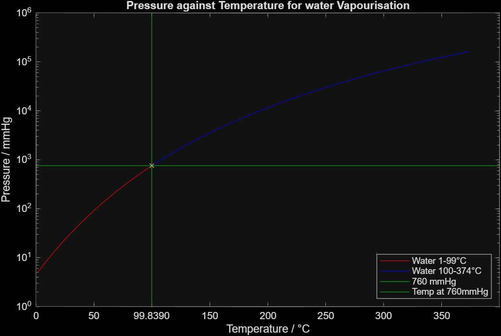

# 01: Vapour Pressure of Water

**Problem:** Plot the vapour pressure of water against temperature from 1 to 374 °C and find where it reaches 1 atm.

#

MATLAB:  
The curve crosses 1 atm at about 99.84°C, which is close to the known boiling point of water.

Python:  
The curve crosses 1 atm at about 100.49°C, which is also close to the known boiling point.

#

**Method**  
Find constants  
Research what equation tells us  
Define constants and temperature range via vectors  
Establish calculation  
Plot results graphically  
Determine temperature at 1 atm   

**Equation (Antoine):** log10(P) = A − B / (C + T)

#

**What I learned:** Keeping the graph linear makes the lower range unreadable (given it is an exponential equation), so a logarithmic scale must be used. It was interesting to see how the two curves diverge when each set of coefficients is plotted over the full range.  
**There is a very small difference between my graphed value (99.84°C) and the known value (99.97°C). The Antoine constants are a fit of data, not an exact law, and the estimated value from the graph via interpolation is a straight line estimate of a curve, and will not be fully exact.**

## Percent Error:

MATLAB:  
The interpolated crossing at 760 mmHg was 99.84 °C against an accepted boiling point of 99.97 °C, a difference of 0.13°C (−0.13%, or −0.035% in kelvin), consistent with the accuracy of Antoine constants fitted over a limited range.

Python:  
The crossing for the python method was 100.49°C against the accepted value of 99.97°C, a difference of 0.52°C (+0.52%, or +0.14% in kelvin). This is a much larger error than the MATLAB method.

#

**Constants:** 

1-99°C (below NBP):  
A = 8.07131 
B = 1730.63 
C = 233.426

99-374°C (above NBP and below critical temperature):  
A = 8.14019
B = 1810.94
C = 244.485

T = Temperature (Degrees Celsius)  
P = Vapour pressure (mmHg) 

#

**Notes:**  
760 mmHg = 1.000 atm = typical atmospheric pressure at sea level  
The equation rearranged for P will be P = 10^(A-B/(C+T))  
The equation, to my knowledge and explanation, shows the pressure at which water vapour and liquid coexist for a given temperature. Essentially the gas-liquid line of a phase diagram.  

Sources, found using SciSpace: 

https://webbook.nist.gov/cgi/cbook.cgi?ID=C7732185&Mask=4&Type=ANTOINE&Plot=on

https://www.theochem.ru.nl/~pwormer/Knowino/knowino.org/wiki/Antoine_equation.html  

Documentation:

https://uk.mathworks.com/help/matlab/ref/semilogy.html?s_tid=ta_help_results

#

**Files:** `vapour_pressure.m` (MATLAB), `vapour_pressure.py` (Python)